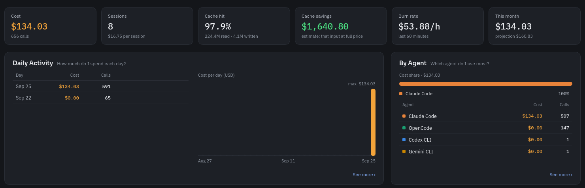
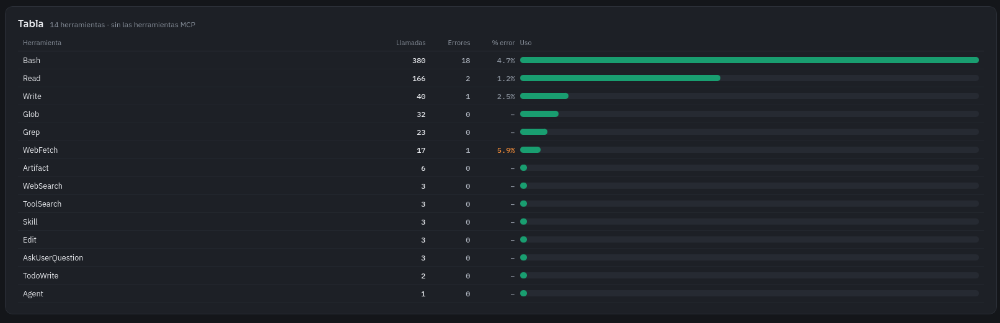

<div align="center">


# AgentBoard

**El panel de coste y actividad de tus agentes de código, en local.**

Reúne en una sola vista qué hacen Claude Code, Codex, Copilot, Cursor, Gemini y OpenCode
—y cuánto cuestan— leyendo los logs que ya tienen en el ordenador. Nada sale de la máquina.

**[Documentación](https://docs.portafolio-renzoramos.com/agentboard/) · [Descargar](https://github.com/RenzoRamosDEV/AgentBoard/releases/latest)**


</div>

---

## Qué es

Los agentes de código —Claude Code, Codex, Copilot, Cursor, Gemini, OpenCode— generan mucha
actividad: llamadas al modelo, tokens, sesiones, herramientas y comandos, y con ello un gasto
que normalmente queda **repartido, opaco y encerrado en cada herramienta**. No hay un sitio que
responda de un vistazo *cuánto llevo gastado este mes*, *qué modelo me sale más caro* o *en qué
se me va el tiempo del agente*.

**AgentBoard es una aplicación de escritorio que responde justo eso.** Cada uno de esos agentes
deja registros (logs) en el ordenador; AgentBoard los **lee, los cruza y los presenta** en un
panel con coste, tokens, sesiones, actividad, herramientas, modelos y proyectos. Todo el trabajo
ocurre en la máquina:

- **Local y privado** — sin proxy, sin claves de API, sin telemetría. Ningún dato sale del equipo.
- **Solo lectura** — lee los logs que ya existen; no toca ni interfiere con el trabajo de los agentes.
- **Caché local reconstruible** — lo leído de los logs se guarda en una caché **SQLite** en la
  carpeta de datos del usuario, solo legible por él, para que el arranque lea solo lo nuevo. Solo
  contiene lo que ya está en los logs (nunca el texto de prompts ni respuestas) y puede borrarse
  en cualquier momento: se reconstruye leyendo los logs. Con **«Solo memoria»** (Ajustes → Datos)
  no se guarda nada en disco salvo los ajustes.

## Para qué sirve

- **Controlar el gasto** — ver el coste del día y del mes, la proyección a fin de mes y un aviso
  al acercarse al presupuesto.
- **Entender el uso** — saber qué agente y qué modelo se usan más, y con qué eficiencia de caché.
- **Ver en qué se trabaja** — el reparto por actividad (coding, testing, debugging…), por
  proyecto y por rama de git.
- **Detectar fricción** — qué herramientas y comandos fallan más.
- **Consultarlo desde otro agente** — vía un servidor MCP, un agente puede preguntar estos datos
  en medio de una conversación.

---

## El panel

<div align="center">



</div>

| El desglose por herramienta | |
|:---:|:---|
|  | Llamadas y porcentaje de error por herramienta, con su barra de uso. Cada apartado tiene su tabla y su gráfico, y una vista ampliada al pulsarlo. |

---

## Qué muestra

Un panel lateral con los apartados agrupados (Coste, Trabajo, Herramientas y Configuración), una
barra superior con los filtros (periodo, agentes, proyectos y comparar con el periodo anterior) y
cada apartado con su tabla y su gráfico.

| | |
|---|---|
| 📊 | **Resumen** — KPIs con su variación frente al periodo anterior, gasto diario por agente, «Hoy en directo» y top de proyectos, modelos y actividades |
| 🧾 | **Proyectos** — cada proyecto con sus agentes, ramas, sesiones, tiempo activo y coste; su detalle baja a cada sesión, con el coste acumulado, los turnos y la latencia de cada herramienta |
| 🏷️ | **Precios y presupuestos** — precios por modelo editables (y aviso de los que faltan); presupuestos mensual, diario y por proyecto o agente |
| 📅 | **Daily Activity** — cuánto se gasta cada día |
| 🤖 | **By Agent** — qué agente se usa más y cuánto cuesta cada uno |
| 📁 | **By Project** — coste por proyecto y por rama, con el *overhead* de contexto |
| 🧭 | **By Activity** — coding, testing, debugging, exploración, conversación… |
| 🧠 | **By Model** — coste, cache hit y llamadas por modelo |
| 🔧 | **Tools / Shell Commands** — uso y errores por herramienta y por comando |
| ✨ | **Skills & Agents / MCP Servers / Agent Types** — skills, subagentes y servidores MCP |

Además: **en vivo** (relee los logs al vuelo con un vigilante de archivos), **bandeja del sistema**
con el gasto del mes, **avisos de presupuesto** (80 % y 100 %, para cada presupuesto), **exportar** a CSV/JSON, **temas**
claro/oscuro/sistema e **idiomas** (es, en, pt, fr).

---

## Qué usa

| Capa | Tecnología | Por qué |
| --- | --- | --- |
| Escritorio | **Tauri 2** | Un solo binario nativo para Linux, Windows y macOS, ligero (usa el WebView del sistema) |
| Núcleo | **Rust** | Lee y agrega los logs rápido y con seguridad de memoria |
| Base de datos | **SQLite (rusqlite)** | Caché local reconstruible (o solo en memoria), agregados diarios y consultas SQL |
| Interfaz | **React + TypeScript + Vite** | Panel, tablas y gráficos hechos a medida |
| En vivo | **notify** | Vigila las carpetas de logs y relee al vuelo |
| Integración | **Model Context Protocol** | Expone los datos a cualquier agente compatible |
| Especificación | **OpenSpec** | Cada cambio se describe antes de implementarse (`openspec/`) |

---

## Cómo está montado

```
┌──────────────────────────┐        ┌──────────────────────────┐
│  Interfaz (React + TS)   │        │  Agente de IA            │
│  panel, tablas, gráficos │        │  (Claude Code, Codex…)   │
└────────────┬─────────────┘        └────────────┬─────────────┘
             │ comandos Tauri                     │ MCP (stdio)
             ▼                                     ▼
        ┌─────────────────────────────────────────────────┐
        │  Núcleo en Rust                                  │
        │  providers · ingesta · consultas · precios       │
        └────────────────────────┬────────────────────────┘
                                 │ escanea (solo lectura)
                                 ▼
   caché SQLite (disco o memoria)  ◀── logs de los agentes en disco
```

- **Un módulo por agente** (`providers/`): detecta el agente, sabe dónde están sus logs y parsea
  sus registros a unos tipos comunes (sesiones, llamadas, turnos, usos de herramienta).
- **Ingesta incremental** por offsets: releer solo procesa lo nuevo y cada llamada se identifica
  por su `message_id`, así que nunca duplica. Un único escritor confirma por lotes; la interfaz
  lee por conexiones aparte, de agregados diarios cuando el periodo son días completos.
- **Caché fiel a los logs**: si un log desaparece, se sustituye o encoge, sus datos se retiran y
  la caché dice lo mismo que leer los logs presentes desde cero.
- **Consultas** agregadas (SQL) que alimentan cada apartado, respetando el filtro común.
- **Precios** por modelo para calcular coste y ahorro por caché.
- **Servidor MCP** aparte que reutiliza todo lo anterior.

Detalle completo en la [wiki](docs/wiki/Home.md) y en [`CONTRIBUTING.md`](CONTRIBUTING.md).

---

## De dónde salen los datos

| Agente | Origen |
| --- | --- |
| Claude Code | `~/.claude/projects/**/*.jsonl` (o `$CLAUDE_CONFIG_DIR`) |
| Codex CLI | `~/.codex/sessions/**/rollout-*.jsonl` (o `$CODEX_HOME`) |
| GitHub Copilot CLI | `~/.copilot/session-state/*/events.jsonl` (o `$COPILOT_HOME`) |
| Cursor CLI | `~/.cursor/projects/*/agent-transcripts/*/*.jsonl` |
| Gemini CLI | `~/.gemini/tmp/*/chats/session-*.jsonl` (o `$GEMINI_CLI_HOME`) |
| OpenCode | base SQLite de OpenCode (lectura incremental) |

Un agente aparece en la lista si está instalado, aunque aún no tenga sesiones; sus datos salen
en cuanto existan. El texto de los prompts y las respuestas no se guarda en ningún sitio.

### La caché

| Sistema | Ruta |
| --- | --- |
| Linux | `~/.local/share/agentboard/cache.sqlite` (o `$XDG_DATA_HOME/agentboard/`) |
| macOS | `~/Library/Application Support/agentboard/cache.sqlite` |
| Windows | `%APPDATA%\agentboard\cache.sqlite` |

Junto a ella pueden aparecer `cache.sqlite-wal` y `cache.sqlite-shm`. En Unix la carpeta es `0700`
y los archivos `0600`. Para borrarla: **Ajustes → Datos → Reconstruir caché**, activar **«Solo
memoria»** (la borra y deja de guardarla) o, con la app cerrada, borrar esos tres archivos. Si la
caché está dañada o es de otra versión, la app la borra y la reconstruye sola. Una versión anterior
de AgentBoard (sin caché) la ignora; ese archivo puede borrarse a mano.

---

## Servidor MCP

`agentboard-mcp` expone los mismos datos a cualquier agente por Model Context Protocol (stdio),
**sin necesitar la app abierta**: escanea los logs a memoria al arrancar y responde por
JSON-RPC. Así un agente puede preguntar «¿cuánto llevo gastado este mes?» o «¿qué modelo me sale
más caro?» durante una conversación.

**Viene incluido en la app.** Al instalar AgentBoard, el servidor queda junto al ejecutable:

| Sistema | Ruta del servidor MCP |
| --- | --- |
| Linux (`.deb` / `.rpm`) | `/usr/bin/agentboard-mcp` |
| Windows | `C:\Program Files\AgentBoard\agentboard-mcp.exe` |
| macOS | `/Applications/AgentBoard.app/Contents/MacOS/agentboard-mcp` |

También se publica suelto en cada release (`AgentBoard-MCP_<versión>_<sistema>`), útil con el
AppImage o si solo se quiere el MCP. Registro en Claude Code:

```bash
claude mcp add agentboard -- /usr/bin/agentboard-mcp
```

20 herramientas (`get_summary`, `get_projects`, `get_sessions`, `get_insights`, `get_daily`…), todas con
filtro opcional de `period`, `agents` y `projects`. Es un servidor MCP estándar: sirve para
Claude Code, Codex, Gemini, Cursor, OpenCode… Guía completa en la
[wiki del MCP](docs/wiki/Servidor-MCP.md).

---

## Instalación

Descarga el instalador de tu sistema desde
[**Releases**](https://github.com/RenzoRamosDEV/AgentBoard/releases):

| Archivo | Qué es |
| --- | --- |
| `AgentBoard-App_<versión>_linux_…` (`.AppImage`, `.deb`, `.rpm`) | La app para Linux (incluye el MCP) |
| `AgentBoard-App_<versión>_windows_…` (`.msi`, `-setup.exe`) | La app para Windows (incluye el MCP) |
| `AgentBoard-App_<versión>_darwin_…` (`.dmg`) | La app para macOS universal (incluye el MCP) |
| `AgentBoard-MCP_<versión>_<sistema>` | Solo el servidor MCP, para registrarlo en un agente |

> [!NOTE]
> Los binarios de Windows y macOS van sin firmar; la primera vez el sistema pedirá confirmación
> (SmartScreen / Gatekeeper).

---

## Desarrollo

Requisitos: Node.js 20+, Rust estable y, en Linux, WebKitGTK 4.1.

```bash
npm ci
npm run tauri dev     # app con recarga en caliente
npm test              # tests del frontend (vitest)
```

Backend y servidor MCP:

```bash
cargo test  --manifest-path src-tauri/Cargo.toml
cargo build --manifest-path src-tauri/Cargo.toml -p agentboard-mcp
```

Cada Pull Request compila y prueba en **Linux, Windows y macOS**. Ver [`CONTRIBUTING.md`](CONTRIBUTING.md).
Resultados de rendimiento (presupuestos, antes y después, pendientes): [`docs/perf/RESULTS.md`](docs/perf/RESULTS.md).

---

## Licencia

[MIT](LICENSE) © Renzo Ramos
